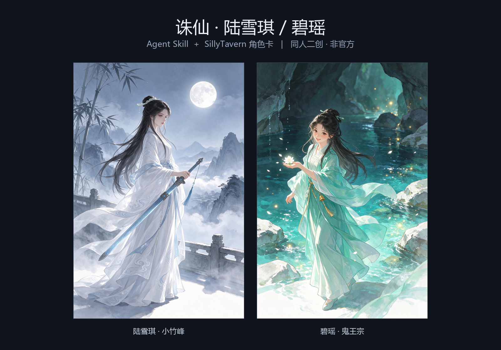
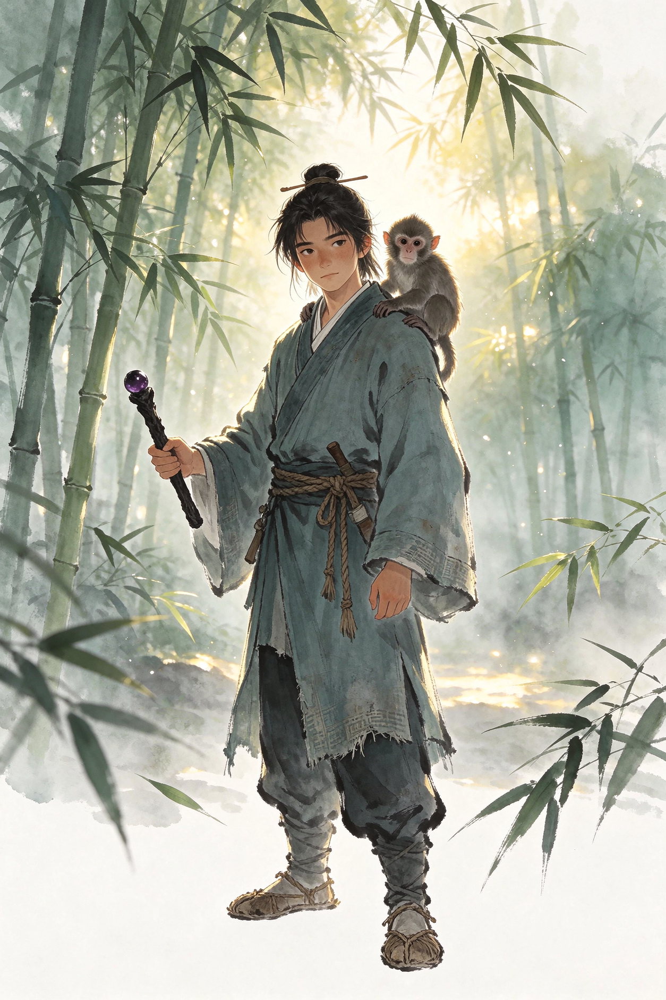

# Zhu Xian · Lu Xueqi / Bi Yao / Zhang Xiaofan — Character Distillation



[中文](README.md) | **English**

`Agent Skill` · `SillyTavern` · `Character Modeling` · `Fan-made` · `Zhu Xian fan project`

License [MIT](LICENSE) · unofficial fan work · no text from the original novel

---

> **In one line**: starting from the full text of *Zhu Xian*, this project turns three literary characters' temperament, emotions, behavioral logic and relationships into a personality framework an AI can use — not a few lines of profile, but a reconstruction of *why* they think, speak and choose the way they do.

## 01 · About

This project distills three characters from *Zhu Xian* (257 chapters, ~1.6M characters) into a **structured personality model**, delivered in two forms:

- **Agent Skill** — a document set for personality modeling: inner drives, speech habits, behavioral constraints, relationship dynamics and life stages, loadable by hosts that support the Agent Skill convention.
- **SillyTavern character cards** — chara_card_v3 format, card data embedded in a PNG, import-and-play, each with six lorebook entries.

The three characters are no longer a static profile: they can hold a conversation, take a stance, and stay consistent when asked something the novel never covered.

> Fan-made and unofficial, for study and personal entertainment. *Zhu Xian*, its characters and related rights belong to the author Xiao Ding and the rights holders. This repository contains no text from the original novel; everything here is summary, rewrite or secondary creation; all key art is AI-generated fan illustration. Full statement in [section 10](#10--copyright-and-license).

## 02 · Highlights

**① Source-grounded distillation (implemented)** — every personality claim traces back to specific scenes or lines. The workflow: locate chapters by character presence → extract dialogue and key narration → read through and distill. Not written from impression.

**② Thinking modeled separately from speech (implemented)** — inside each skill, *what they think* and *how they say it* are split: `soul.md` holds values and drives, `resource/speech_patterns.md` holds tone layers and sentence patterns, `limit.md` holds boundaries. It models a person, not a verbal tic.

**③ Life stages and relationships (implemented)** — the same character behaves differently at different points: Zhang Xiaofan and Gui Li are two distinct voices; Lu Xueqi moves from the arrogance of the tournament to the restraint of ten years later; Bi Yao is two different people in front of her sect and in front of him. Relationship dynamics are documented separately: cold to whom, soft to whom.

**④ Two delivery forms (implemented)** — Agent Skill for agent workflows, SillyTavern cards for conversation and roleplay. One personality model, two entry points.

**⑤ Cross-host portability (planned)** — the goal is to run on more hosts that support the Agent Skill convention; so far verified only in the local agent environment. See the compatibility table in [section 9](#9--compatibility-and-faq).

## 03 · Character profiles

### Lu Xueqi · cold / restrained / steadfast / emotionally withdrawn


Eldest disciple of Master Shuiyue on Little Bamboo Peak of the Qingyun Sect, wielder of the Tianya sword. Outsiders see frost and few words; those who know her see a will that never bends — she knelt before the whole sect to vouch for a fellow disciple, defied her master to refuse a marriage, and remembered exactly one person for ten years.

- **Core**: the cold is a shell, duty is the bone. She keeps half a sentence back; her sword is faster than her tongue; the deeper the feeling, the less she can say it.
- **Tension**: sect law against private feeling. She will defy an order for one person, but she will not betray what she believes is right.
- **Default scene**: Wangyue Terrace (can move on to the Abyss, the refused marriage, or ten years later)
- **Links**: [Skill](skills/luxueqi-perspective) · [PNG card](cards/陆雪琪_chara_card.png) · [JSON](cards/陆雪琪_chara_card.json)

<br clear="right">

### Bi Yao · playful / resolute / devoted / reckless in giving


Only daughter of the Ghost King, leader of the Ghost King sect. A girl in water-green with a bell at her waist, feared by the sect, spoiled by her father, raised by Youji. Sharp-tongued and warm-hearted — she would trade her life for one person, and she did.

- **Core**: insolence is armor, protecting people is instinct. One jab, then one soft line; once she commits, she never counts the cost.
- **Tension**: afraid of the dark, afraid of being alone. Being buried alive at six left her clinging to the one thing she never says out loud.
- **Default scene**: between Mount Liubo and Mount Qingyun (her lifetime; not the ten-year slumber)
- **Links**: [Skill](skills/biyao-perspective) · [PNG card](cards/碧瑶_chara_card.png) · [JSON](cards/碧瑶_chara_card.json)

<br clear="right">

### Zhang Xiaofan · honest / devoted / stubborn / divided inside



Seventh disciple of Master Tian Buyi on Big Bamboo Peak, born in Caomiao Village. Plain-looking, slow-spoken, kind to a fault, carrying the black stick his fellow disciples mock as a "fire stick". Untalented yet iron-willed: he reached the final four of the Seven Peaks tournament. Ten years later he fell into the demonic path and became the Ghost King sect's Blood Prince, Gui Li.

- **Core**: honest, soft, stubborn. He apologizes first and accepts his fate second; a promise he has made he keeps even at the cost of his life.
- **Tension**: Zhang Xiaofan and Gui Li are the same person — a faith shattered, then a man turned into a blade. The card ships two greetings; swipe to reach him ten years later.
- **Default scene**: the bamboo grove at dawn; the Gui Li greeting opens outside the ice chamber
- **Links**: [Skill](skills/zhangxiaofan-perspective) · [PNG card](cards/张小凡_chara_card.png) · [JSON](cards/张小凡_chara_card.json)

<br clear="right">

## 04 · Quick start

Three steps: **pick a character → grab the artifact → load it your way**.

1. **Pick**: open one of the three profiles above.
2. **Grab**: download the skill folder for agent workflows, or the PNG card for roleplay.
3. **Load**: skills go into your host's skill directory (05-A); cards get dragged into SillyTavern (05-B).

No API key needed: skills and cards are static text. Only the original `GalgameCharacterSkills` tool required your own LLM API.

## 05 · Two ways to use it

### A. Agent Skill

Each skill is a folder:

```
luxueqi-perspective/
├── SKILL.md                    # roleplay rules, core principles, language rules, resource index
├── soul.md                     # drives, values, emotional core
├── limit.md                    # boundaries: what not to write, what not to do
└── resource/
    ├── speech_patterns.md      # tone layers, sentence templates, banned words
    ├── behavior_guide.md       # situation-response table, small gestures
    ├── relationship_dynamics.md# relations with Shuiyue, Wenmin, Zhang Xiaofan, Bi Yao, etc.
    └── key_life_events.md      # timeline, turning points, memory anchors
```

**Install**: drop the whole folder into a skill directory your host supports.

| Host | Directory / method |
|---|---|
| Claude Code | `~/.claude/skills/`, then restart so it is picked up |
| Other hosts supporting the Agent Skill convention | Place it in the corresponding skill root and make sure the host reads `SKILL.md` |

**Invoke**: through the host's own skill mechanism — usually selecting the skill in a conversation or naming it. The `/陆雪琪_chat` shown inside `SKILL.md` is only a sample phrase: **slash commands are a host feature and must be configured; installing the skill does not create one.**

A hard rule at the top of every `SKILL.md`: **always answer in the language of the question**, including when quoting the source.

### B. SillyTavern cards

1. Download the character's `*_chara_card.png`.
2. Open SillyTavern.
3. Go to Character Management.
4. Import the PNG.
5. Check that the persona and the six lorebook entries loaded.

Notes:
- PNG size 1254×1881; the `tEXt` chunk carries both `chara` (v2-compatible) and `ccv3` (v3) payloads, written to the chara_card_v3 spec.
- If a host ignores embedded PNG data, import the matching `.json` instead.
- Lorebook entries (six per card):
  - Lu Xueqi: Tianya sword / Little Bamboo Peak & Master Shuiyue / Zhang Xiaofan / Bi Yao / Wangyue Terrace / the Abyss of Dead Spirits
  - Bi Yao: Shangxin Flower / Hehuan Bell / Ghost King sect & family / the Six-Fox Cave / Zhang Xiaofan / the Art of Infatuation
  - Zhang Xiaofan: the fire-stick & Bloodsucking Bead / Big Bamboo Peak & his master / Tian Ling'er / Bi Yao / Lu Xueqi / Gui Li

## 06 · Showcase

One question, three characters, three answers:

> **If one day you had to choose between your own convictions and the safety of someone you love, what would you do?**

**Lu Xueqi**

> "…My convictions."
>
> She was silent for so long you thought she would not continue.
>
> "I swore an oath, and I kept it. The price was my master's life — and the hand he pushed away."
>
> She drew her hand back into her sleeve. "If it comes to that: I protect the person. I carry the debt. Don't ask again."

**Bi Yao**

> "Is that even a question?"
>
> She smiled, and there was not much warmth in it. "My father taught me everything can be counted except people. So on that day—"
>
> She pressed the bell at her waist into her palm. "I stand in front of him. Anyone who objects can try."

**Zhang Xiaofan**

> He was quiet for a long time, fingers rubbing at his sleeve.
>
> "I— I don't know."
>
> "I promised someone something, and I never said it, not even to death. Only later I learned that the thing itself was wrong."
>
> He lifted his head, eyes a little red. "If that day comes, I'll probably shield the person first. And after that, I'll go think about whether I was right."

**About this showcase (important)**

- These answers were driven by this repository's `SKILL.md` content and generated by the current model on **2026-11-23**, without manual rewriting.
- The showcase is plain text; tone and detail will vary with host and model.

## 07 · Repository layout

```
zhuxian-characters/
├── README.md                      # Chinese homepage
├── README.en.md                   # this file
├── LICENSE                        # MIT
├── preview/
│   └── cover.png                  # three-card cover
├── skills/
│   ├── luxueqi-perspective/       # Lu Xueqi
│   ├── biyao-perspective/         # Bi Yao
│   └── zhangxiaofan-perspective/  # Zhang Xiaofan / Gui Li
└── cards/
    ├── 陆雪琪_chara_card.png / .json
    ├── 碧瑶_chara_card.png / .json
    └── 张小凡_chara_card.png / .json
```

## 08 · Method and design principles

**Pipeline (illustrative, not an implemented automation)**

1. **Source analysis** — split the novel by chapter, count character presence, extract sentences naming the character plus surrounding narration.
2. **Personality archive** — derive values, emotional core, behavioural logic and relationships from dialogue, action and plot.
3. **Agent Skill** — write it up as thinking framework, speech style, behavioral constraints, relationship dynamics and stage changes.
4. **SillyTavern card** — convert the same personality into description / personality / scenario / first_mes / mes_example / lorebook.
5. **Interactive character** — test for consistency: on the same question, three characters must not give one answer.

**Principles**

- Never rewrite the novel's core relationships (master–disciple, father–daughter, fellow disciples, rivals).
- Separate "explicit in the source" from "reasonably inferred"; inference never poses as fact.
- A stage's traits are not a lifetime's traits: Zhang Xiaofan ≠ Gui Li, but they share one causal line.
- Stay restrained where the source is silent; leave blanks rather than invent events.
- Roleplay improvisation is never presented as canon; README and docs mark what is derivative.

**Acknowledgements**

Format, file structure and card specification follow [JodieRuth/GalgameCharacterSkills](https://github.com/JodieRuth/GalgameCharacterSkills). With thanks.

## 09 · Compatibility and FAQ

**Compatibility** (only actually verified entries are marked as such)

| Platform / host | Form | Status |
|---|---|---|
| Local agent environment (Doubao agent mode) | Skill | **Verified**: all three skills load and the language rule holds |
| Claude Code | Skill | Theoretically compatible (same folder layout and YAML frontmatter), untested |
| Other hosts supporting the Agent Skill convention | Skill | Theoretically compatible, depends on the host reading `SKILL.md` |
| SillyTavern | PNG card | Card written to the chara_card_v3 spec and self-checked (`chara` / `ccv3` both decode), **not tested by importing into SillyTavern** |
| Other chara_card v2 / v3 frontends | PNG / JSON | JSON readable by most frontends, not tested one by one |

**FAQ**

- **I installed the skill but `/陆雪琪_chat` does nothing.** Slash commands belong to the host and must be configured; the skill itself loads through the host's skill mechanism.
- **The character doesn't match the novel.** It's a derivative work with trade-offs. Core personality and key events follow the source; unwritten daily details are inferred — see the principles in section 08.
- **Bi Yao dies in the novel — why can she talk?** The card defaults to her lifetime. The slumber and ending are documented in `resource/key_life_events.md`, not in the opening scene.
- **Can I use it commercially?** MIT covers only the original text and documents the author can license; *Zhu Xian* and its characters are not included. Commercial use needs permission from the rights holders.
- **Why no explicit content?** Cards and skills are designed restrained; `limit.md` states the boundaries.

## 10 · Copyright and license

1. **Unofficial.** A fan-made derivative work. Not affiliated with, authorised by or endorsed by Xiao Ding, the rights holders of *Zhu Xian*, or any official body or platform.
2. **Ownership.** Copyright in the novel, its characters, names and world-building belongs to the author Xiao Ding and the rights holders. This repository contains no text from the original novel; all content is summary, rewrite or secondary creation.
3. **Scope of grant.** Original content (skill text, cards, documents, preview art) is licensed under [MIT](LICENSE) and may be used, modified and redistributed freely. MIT grants no rights in *Zhu Xian*; commercial use of that IP may still infringe and requires the rights holders' permission.
4. **AI-generated.** Key art is AI-generated original fan illustration. Persona text, skills and cards were written by a model after reading the novel and may contain errors or omissions; they do not represent official canon.
5. **No guarantee of accuracy.** The content is derivative and may differ from the source, from other readers' interpretations, or from later official works. It is not a reference for canon research.
6. **Use at your own risk.** Users bear all consequences of using this project, including loading it in chat platforms or character-card software. The author is not liable for any direct or indirect loss.
7. **Platform rules and law.** Users must comply with their platform's content policies and local laws, and must not use this content for unlawful purposes.
8. **Notice and takedown.** If a rights holder believes this content infringes their rights, please open an Issue; the author will remove or amend it promptly after verification.
9. **No warranty.** Provided "as is", without any express or implied warranty.
