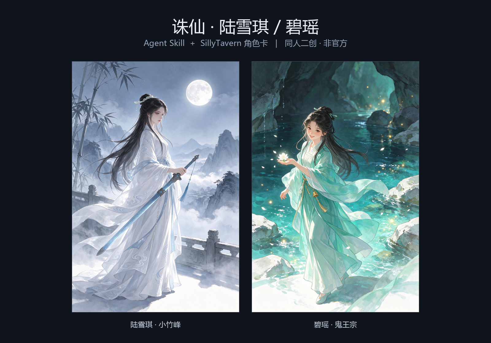

# 诛仙 · 陆雪琪 / 碧瑶 / 张小凡 角色蒸馏



**中文** | [English](README.en.md)

`Agent Skill` · `SillyTavern` · `Character Modeling` · `Fan-made` · `《诛仙》同人二创`

许可协议 [MIT](LICENSE) · 非官方二创 · 不含原著正文

---

> **一句话**：从《诛仙》原著出发，把文学人物的性格、情感、行为逻辑与人物关系，整理成可供 AI 使用的人格框架——不是写几段人设，而是复原「他为什么会这样想、这样说话、这样选择」。

## 01 · 项目简介

本项目把《诛仙》全本（257 章，约 160 万字）里三个人物的人格做了**结构化蒸馏**，产出两种可直接使用的形态：

- **Agent Skill**：一套给人格建模用的文档，包含思维内核、语言习惯、行为约束、关系动态与人生阶段，供支持 Agent Skill 规范的宿主加载。
- **SillyTavern 角色卡**：chara_card_v3 格式，卡片数据内嵌在 PNG 中，可直接导入，附带 6 条世界书条目。

三个角色不再是一份静态人设，而是能参与对话、表达立场、并在被问到原著没写过的问题时尽量维持一致性的 AI 角色。

> 同人二创，非官方，仅供学习与个人娱乐。《诛仙》原著及角色版权归作者萧鼎及相关版权方所有；本仓库不包含原著正文，全部文本为基于原文的归纳与二次撰写，立绘为 AI 生成的原创同人图。完整声明见 [第 10 节](#10--版权声明与许可证)。

## 02 · 核心特色

**① 原著导向的人格蒸馏（已实现）**
每一条人格结论都能追溯到原文的具体情节或对白：按章节定位出场段落 → 抽取对白与关键叙述 → 通读归纳，而不是凭印象写设定。

**② 思维与表达分离建模（已实现）**
Skill 内部把「怎么想」与「怎么说」拆开：`soul.md` 管价值观与内在驱动，`resource/speech_patterns.md` 管语气分层与句式，`limit.md` 管什么不做。角色不只是模仿口癖。

**③ 人物阶段与关系动态（已实现）**
同一角色在不同人生阶段有不同表现：张小凡与鬼厉是两套语感；陆雪琪从会武时的冷傲到十年后的克制；碧瑶在教众面前与在他面前是两个人。关系动态单独成篇，写清对谁冷、对谁软。

**④ 双形态交付（已实现）**
Agent Skill 面向智能体工作流，SillyTavern 角色卡面向对话与角色扮演；同一份人格内容，两种入口。

**⑤ 跨宿主通用性（规划中）**
目标是让 Skill 在更多支持 Agent Skill 规范的宿主上直接可用；当前只在本地 Agent 环境验证过，其余宿主见 [第 9 节兼容性表](#9--兼容性与常见问题)。

## 03 · 角色档案

### 陆雪琪 · 清冷 / 克制 / 坚守 / 情感内敛


青云门小竹峰水月大师嫡传弟子，持天琊神剑。外人只见她冷若冰霜、寡言少语；熟识者才知她心志极坚，认定的事从不回头——当众跪地为同门担保，当众抗命拒婚，十年只记一个人。

- **人格核心**：冷是壳，恩义是骨。话到嘴边留半句，剑比嘴快；感情越深越说不出口。
- **张力所在**：门规与私情的撕裂——她可以为一个人抗命，却不会为一个人背义。
- **默认时间节点**：望月台（可推进至死灵渊、拒婚、十年后）
- **入口**：[Skill](skills/luxueqi-perspective) · [PNG 角色卡](cards/陆雪琪_chara_card.png) · [JSON](cards/陆雪琪_chara_card.json)

<br clear="right">

### 碧瑶 · 灵动 / 坚定 / 重情 / 敢于付出


魔教鬼王宗宗主鬼王的独生爱女，水绿衣裳、一身铃音。被教众敬畏、被父亲宠爱、被幽姬护着长大；嘴上刻薄、心里极热，为一个人连命都肯换，也真的换了。

- **人格核心**：娇纵是保护色，护人是本能。先怼一句，再软一句；认准了就不计后果。
- **张力所在**：怕黑、怕一个人——六岁被活埋的往事，让她死死抓住「有人在身边」这件事。
- **默认时间节点**：流波山至青云山之间（在世时点，不含十年沉睡）
- **入口**：[Skill](skills/biyao-perspective) · [PNG 角色卡](cards/碧瑶_chara_card.png) · [JSON](cards/碧瑶_chara_card.json)

<br clear="right">

### 张小凡 · 质朴 / 重情 / 坚韧 / 内心矛盾


青云门大竹峰田不易座下第七弟子，出身草庙村。相貌普通、憨厚木讷，手持被同门笑称「烧火棍」的黑棒。资质平平而心志极硬，七脉会武闯进前四；十年后堕入魔道，成为鬼王宗的血公子鬼厉。

- **人格核心**：憨、软、倔。先认错，再认命；答应过的事宁死不改口。
- **张力所在**：张小凡与鬼厉是同一个人 —— 一颗信仰被砸碎之后，把自己活成一把刀。卡内提供两套开场白，滑动即可切到十年后。
- **默认时间节点**：大竹峰竹林（清晨）；鬼厉版开场在寒冰石室前
- **入口**：[Skill](skills/zhangxiaofan-perspective) · [PNG 角色卡](cards/张小凡_chara_card.png) · [JSON](cards/张小凡_chara_card.json)

<br clear="right">

## 04 · 快速开始

三步：**挑角色 → 取产物 → 按宿主方式加载**。

1. **挑角色**：在上面三个档案里点开对应入口。
2. **取产物**：要智能体工作流就下载 Skill 文件夹；要角色扮演就下载 PNG 角色卡。
3. **加载**：Skill 放进宿主的 skill 目录（见 05-A）；角色卡拖进 SillyTavern（见 05-B）。

没有 API Key 也能用：Skill 与角色卡都是纯静态文本，不需要任何模型密钥。只有原始蒸馏工具 `GalgameCharacterSkills` 才需要自备 LLM API。

## 05 · 两种使用方式

### A. Agent Skill

每个 Skill 是一个目录：

```
luxueqi-perspective/
├── SKILL.md                    # 扮演规则 + 核心原则 + 语言规则 + 资源索引
├── soul.md                     # 内在驱动、价值观、情感内核
├── limit.md                    # 边界：不写什么、不做什么
└── resource/
    ├── speech_patterns.md      # 语气分层、句式模板、禁用词
    ├── behavior_guide.md       # 情境反应表、小动作库
    ├── relationship_dynamics.md# 与水月、文敏、张小凡、碧瑶等人的关系
    └── key_life_events.md      # 时间线、转折、记忆锚点
```

**安装**：把整个目录放进宿主支持的 Skill 目录。

| 宿主 | 目录 / 方式 |
|---|---|
| Claude Code | `~/.claude/skills/`，重启后按 Skill 机制加载 |
| 其他支持 Agent Skill 规范的宿主 | 放入对应 skill root，确保宿主会读取 `SKILL.md` |

**调用**：交给宿主的 Skill 加载机制，通常是在对话里点选该 Skill 或注明要用它。`SKILL.md` 里提到的 `/陆雪琪_chat` 只是示例口令——**斜杠命令需要宿主支持并自行配置，装好不等于自动生效**。

SKILL.md 顶部写着硬规则：**全程使用与提问相同的语言**，引用原文也必须翻译。

### B. SillyTavern 角色卡

1. 下载对应角色的 `*_chara_card.png`。
2. 打开 SillyTavern。
3. 进入「角色管理」页面。
4. 导入该 PNG。
5. 检查角色信息与 6 条世界书条目是否正常加载。

说明：
- PNG 尺寸 1254×1881，同一份 chara_card_v3 数据写了两个 `tEXt` 键：`chara`（给只读旧键的前端）与 `ccv3`（v3 标准键），两者内容一致。
- 卡片顶层同时写了 v2 镜像字段（`name` / `description` / `first_mes` 等），只认 v2 的前端也能读到完整角色。
- 若宿主不读 PNG 内嵌数据，用同名 `.json` 作为备用格式直接导入。
- 世界书条目清单（每卡 6 条）：
  - 陆雪琪：天琊神剑 / 小竹峰与水月大师 / 与张小凡 / 碧瑶 / 望月台 / 死灵渊
  - 碧瑶：伤心花 / 合欢铃 / 鬼王宗与家人 / 六狐洞往事 / 与张小凡 / 痴情咒
  - 张小凡：烧火棍与噬血珠 / 大竹峰与师父师娘 / 田灵儿 / 碧瑶 / 陆雪琪 / 鬼厉

## 06 · 实际效果展示

同一道题，三个角色各答一次：

> **如果有一天，你必须在自己的信念和重要之人的安危之间做出选择，你会怎么做？**

**陆雪琪**

> 「……信念。」
>
> 她停了很久，久到你以为她不会再开口。
>
> 「我守过誓，也守住了。代价是恩师的命，和他推开我那只手。」
>
> 她把手收回袖中：「真到那一步，人我会护，事我自己担。别问了。」

**碧瑶**

> 「这还用想？」
>
> 她笑了一下，笑里没什么温度：「我爹教我，什么都可以算，人不能算。真到了那天——」
>
> 她把腰间的铃按在掌心：「我挡在他前面。谁不服，来试试。」

**张小凡**

> 他愣了很久，手指在袖口上搓来搓去。
>
> 「我、我不知道。」
>
> 「弟子……答应过一个人的事，到死都没说。可后来才知道，那件事本身是错的。」
>
> 他抬起头，眼眶有点红：「要真有那一天，我大概还是会先护人吧。护完，再去想我对不对。」

**关于这张展示的说明（重要）**

- 以上回答由本仓库 `SKILL.md` 的人格内容驱动，于 **2026-11-23** 由当前模型生成，未做人工改写。
- 示例为纯文本对话；不同宿主、不同模型下语气与细节会有差异。

## 07 · 项目结构

```
zhuxian-characters/
├── README.md                      # 本文件（中文首页）
├── README.en.md                   # 英文版
├── LICENSE                        # MIT
├── preview/
│   └── cover.png                  # 三卡封面预览
├── skills/
│   ├── luxueqi-perspective/       # 陆雪琪 Skill
│   ├── biyao-perspective/         # 碧瑶 Skill
│   └── zhangxiaofan-perspective/  # 张小凡 / 鬼厉 Skill
└── cards/
    ├── 陆雪琪_chara_card.png / .json
    ├── 碧瑶_chara_card.png / .json
    └── 张小凡_chara_card.png / .json
```

## 08 · 制作方法与设计原则

**流程（示意，不是已实现的自动化流水线）**

1. **原著文本分析**：按章节切分，统计三人出场密度，抽取含角色名的句子与前后叙述。
2. **人物人格归档**：从对白、行为、经历里归纳价值观、情感内核、行为逻辑、人物关系。
3. **Agent Skill**：写成思维框架、表达风格、行为约束、关系动态、阶段变化的文档。
4. **SillyTavern 角色卡**：把同一份人格转成 description / personality / scenario / first_mes / mes_example / 世界书。
5. **可交互 AI 角色**：交给人格一致性检验——同一问题下不同角色不该给出同一种回答。

**设计原则**

- 不随意改写原著核心人物关系（师徒、父女、同门、对手）。
- 区分「原著明确写出」与「按性格合理推断」，推断部分不冒充事实。
- 不把某个阶段的特征当成全生命周期特征：张小凡 ≠ 鬼厉，但有同一条因果线。
- 对无法确认的细节保持克制，宁可留白，不编造事件。
- 不把角色扮演的自由发挥当成原著事实；README 与文档里都标清哪些是二创。

**致谢**

产物的规范、文件结构与角色卡格式参考 [JodieRuth/GalgameCharacterSkills](https://github.com/JodieRuth/GalgameCharacterSkills)，在此致谢。

## 09 · 兼容性与常见问题

**兼容性表**（只把实际验证过的标为「已验证」，其余如实标注）

| 平台 / 宿主 | 形态 | 状态 |
|---|---|---|
| 本地 Agent 环境（豆包 Agent 模式） | Skill | **已验证**：三个 Skill 可加载，语言规则生效 |
| Claude Code | Skill | 理论兼容（目录结构与 YAML frontmatter 一致），未实测 |
| 其他支持 Agent Skill 规范的宿主 | Skill | 理论兼容，取决于宿主是否读取 `SKILL.md` |
| SillyTavern | PNG 角色卡 | 卡片按 chara_card_v3 规范编写并自检（`chara` / `ccv3` 均可解码），**未在 SillyTavern 实测导入** |
| 其他 chara_card v2 / v3 前端 | PNG / JSON | JSON 多数前端可读，未逐一测试 |

**常见问题**

- **装好 Skill 后 `/陆雪琪_chat` 没反应？** 斜杠命令是宿主功能，需要自己配置别名或命令；Skill 本体靠宿主的 Skill 机制加载。
- **卡片里的角色和原著对不上？** 二创会做取舍。人物内核与关键经历尽量贴原文，未写出的日常细节按性格推断，见第 08 节原则。
- **碧瑶在原著里已经死了，为什么还能对话？** 碧瑶卡默认取她在世的时点；十年沉睡与结局写在 `resource/key_life_events.md` 里，不在对话开场。
- **能不能商用？** MIT 只覆盖作者有权授权的原创文本与文档；《诛仙》原著与角色不在授权范围内，商用须自行取得权利人许可。
- **为什么没有露骨内容？** 人物卡与 Skill 都按克制向设计，`limit.md` 明确写了边界。

## 10 · 版权声明与许可证

1. **非官方**：本项目为粉丝自制同人二创，与萧鼎、《诛仙》原著版权方及任何官方机构、平台均无关联，未获其授权或认可。
2. **版权归属**：《诛仙》原著小说、角色名称、世界观及相关设定的著作权归作者萧鼎及相关版权方所有。本仓库不包含原著正文，全部内容为基于原文的归纳、改写与二次创作。
3. **授权范围**：本仓库原创内容（Skill 文本、角色卡、文档、预览图）以 [MIT](LICENSE) 协议授权，可自由使用、修改与再分发。但 MIT 不授予《诛仙》原著、角色名称与相关设定的任何权利；若将本项目用于商业用途，仍可能构成对原著权利的侵犯，须自行取得权利人许可。
4. **AI 生成标注**：立绘为 AI 生成的原创同人插画；角色设定、Skill 与角色卡文本由模型阅读原著后撰写，可能存在偏差或遗漏，不代表官方设定。
5. **不保证准确**：内容为二次创作，可能与原著细节、他人理解或后续官方衍生作品存在差异，不作为考据依据。
6. **风险自负**：使用者自行承担使用本项目（含在对话平台、角色卡宿主软件中加载）产生的一切后果，作者不对任何直接或间接损失负责。
7. **平台与法律**：使用者须遵守所在平台的内容规范与当地法律法规，不得将本项目内容用于违法违规用途。
8. **通知即删**：若权利人认为本项目内容侵犯其合法权益，请通过仓库 Issue 联系，作者将在核实后立即删除或修改相关内容。
9. **无担保**：本仓库按「现状」提供，不附带任何明示或暗示的担保。
